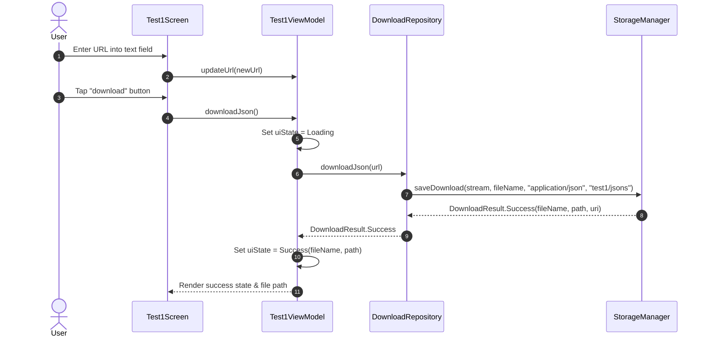

# Feature Specification: Test 1 - Get JSON

## 1. Overview
The **Test 1** feature allows users to provide an arbitrary HTTP/HTTPS URL, download a JSON payload, and persist it to the device's public storage with a timestamp-formatted filename.

---

## 2. User Stories & Business Requirements

- **User Story:** As an experimental app tester, I want to paste a public JSON URL and tap a download button so that the JSON response is safely stored in `Downloads/test1/jsons/` without requiring intrusive device storage permissions.
- **Business Rules:**
  - The URL must be validated to ensure it begins with `http://` or `https://`.
  - Empty or whitespace-only URL inputs must immediately trigger a validation error without initiating network calls.
  - JSON downloads must be stored under `Downloads/test1/jsons/`.
  - The file name must strictly follow the timestamp pattern: `yyyyMMdd_HHmmss.json` (reflecting the exact moment the file is saved).
  - The MIME type registered in `MediaStore` must be `application/json`.
  - All UI strings must be defined in Android resource files (`res/values/strings.xml`).

---

## 3. UI & Interaction Flow

### 3.1 Screen Components
- **Top Bar:** Screen title ("Test 1 - Get JSON") and back button navigating back to `MenuScreen`.
- **Input Field:** Outlined text input with placeholder and label ("Enter JSON URL").
- **Action Button:** Centered button styled with primary green background and labeled "download".
- **Feedback Container:**
  - While downloading: Circular progress indicator with "Downloading..." status.
  - On success: Green text showing the saved file name and full path (`Download/test1/jsons/<timestamp>.json`).
  - On error: Red error message explaining the failure (e.g., HTTP 404, invalid URL, network timeout).

---

## 4. Technical Constraints
- Asynchronous execution must run on `Dispatchers.IO`.
- Android 10+ (API 29+) MediaStore scoped storage must be utilized.
- HTTP requests must have a 30s connection timeout and 60s read timeout via OkHttp.
