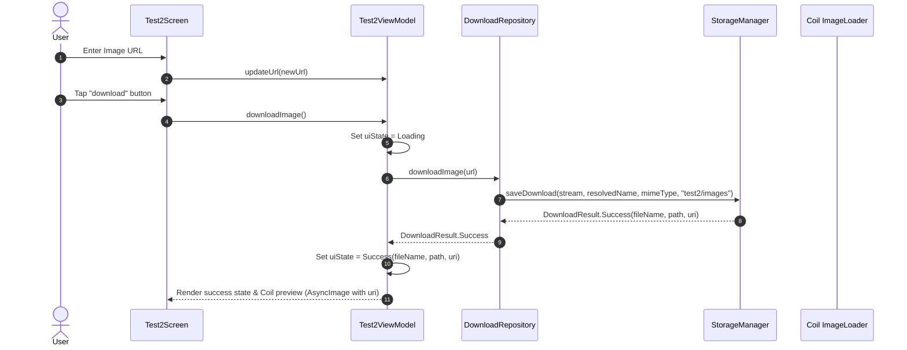

# Feature Specification: Test 2 - Get Image

## 1. Overview
The **Test 2** feature enables downloading an image from a user-specified URL, resolving its original filename and extension dynamically from HTTP headers and URL patterns, storing it under `Downloads/test2/images/`, and displaying a live preview in the app using Coil.

---

## 2. User Stories & Business Requirements

- **User Story:** As an experimental app tester, I want to paste an image URL, tap "download", and have the image downloaded to `Downloads/test2/images/` with its real name/extension while previewing the downloaded image on screen.
- **Business Rules:**
  - The URL must be validated to ensure it starts with `http://` or `https://`.
  - Storage destination must be `Downloads/test2/images/`.
  - **Dynamic File Name & Extension Resolution Sequence:**
    1. **`Content-Disposition` Header:** Inspect for `filename="..."` or `filename*="..."`. If present and valid, sanitize and use it.
    2. **URL Path Segment:** If header is missing, extract the last path segment from the URL (e.g., `wallpaper.png`).
    3. **MIME Type Mapping:** Extract extension from the `Content-Type` header (mapping `image/jpeg` -> `.jpg`, `image/png` -> `.png`, `image/webp` -> `.webp`, `image/gif` -> `.gif`, `image/svg+xml` -> `.svg`).
    4. **Timestamp Fallback:** If no filename is available, generate `image_yyyyMMdd_HHmmss.<ext>`.
  - Filenames must be sanitized: only alphanumeric characters, dots (`.`), dashes (`-`), and underscores (`_`) are preserved; all others are replaced with `_`.
  - Successful downloads must show an in-app preview of the downloaded image using Coil.

---

## 3. UI & Interaction Flow

### 3.1 Screen Components
- **Top Bar:** Screen title ("Test 2 - Get Image") and back button navigating to `MenuScreen`.
- **Input Field:** Outlined text input with placeholder and label ("Enter Image URL").
- **Action Button:** Centered button styled with primary green background and labeled "download".
- **Image Preview Box:** Box with border and rounded corners that renders the image via Coil `AsyncImage` when `uiState` is `Success`.
- **Feedback Container:**
  - While downloading: Progress indicator with "Downloading image..." message.
  - On success: Green status showing the resolved file name and full destination path.
  - On error: Red error message explaining the failure reason.
