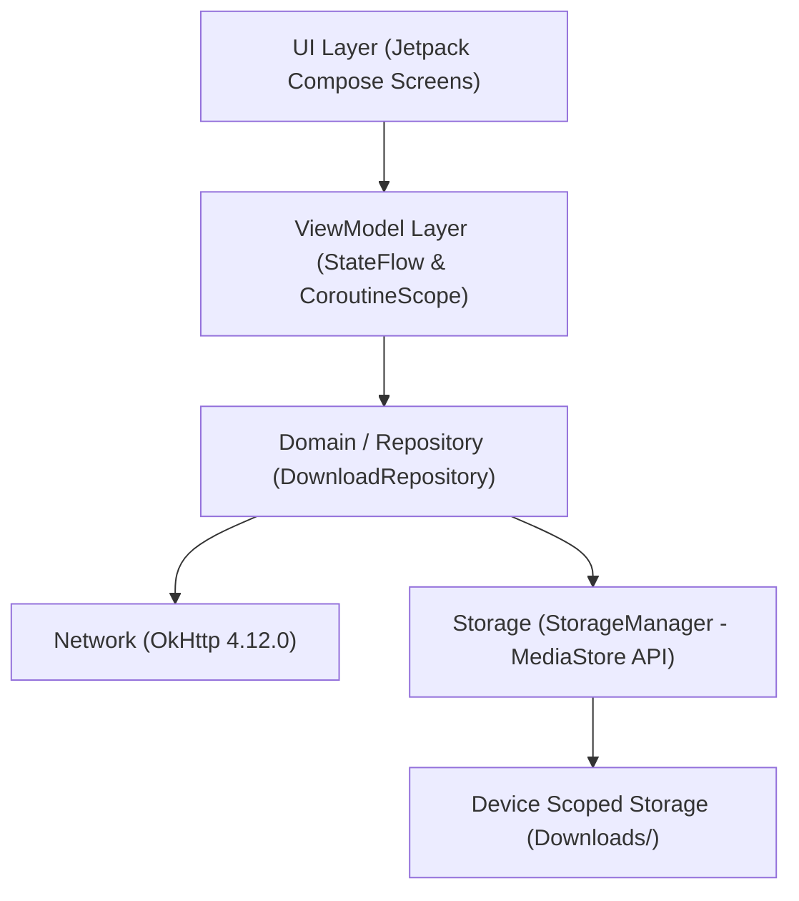

# System Architecture Specification

## 1. Executive Overview
The **Personal Android Application** is an experimental mobile client designed with modern Android best practices, built using **Kotlin**, **Jetpack Compose** (Material 3), and **Java 17** bytecode compatibility. It adheres to the **MVVM (Model-View-ViewModel)** architectural pattern and leverages a containerized development workflow via **Docker** to eliminate the need for a local Android Studio installation.

---

## 2. Technical Stack & Tooling

| Component | Technology / Library | Version | Description |
| :--- | :--- | :--- | :--- |
| **Language** | Kotlin / Java | Kotlin 1.9.22 / JVM 17 | Primary programming language with Java 17 bytecode compatibility |
| **UI Toolkit** | Jetpack Compose | BOM 2024.02.00 / M3 | Declarative UI framework using Material Design 3 |
| **Build Tool** | Gradle / AGP | Gradle 8.5 / AGP 8.2.2 | Build automation and Android Gradle Plugin |
| **Container Environment** | Docker | `mobiledevops/android-sdk-image:34.0.0` | Headless SDK environment for building and testing |
| **HTTP Client** | OkHttp | 4.12.0 | Networking library for synchronous and streaming HTTP requests |
| **Concurrency** | Kotlin Coroutines & Flow | 1.8.0 | Structured concurrency (`Dispatchers.IO`) and reactive StateFlow |
| **Image Loading** | Coil | 2.5.0 | Async image loading and rendering in Compose |
| **Target SDKs** | Android SDK | Min: 26 (Android 8.0) / Target: 34 (Android 14) | Compatibility range |

---

## 3. Architecture Layers & Design Patterns

The application follows Clean MVVM guidelines to ensure testability, separation of concerns, and unidirectional data flow:

### 3.1 Presentation / UI Layer (`com.personal.androidapp.ui`)
- **Jetpack Compose:** Completely declarative UI built with Material 3 components, theme tokens, and typography.
- **Unidirectional Data Flow (UDF):** Screens observe immutable state streams (`StateFlow`) and emit user actions as callbacks to the ViewModels.
- **Navigation:** Managed by `AppNavHost` using Jetpack Compose Navigation with route constants defined in the `Screen` sealed class (`menu`, `test1`, `test2`).
- **Core Screens:**
  - `MenuScreen`: Root screen listing test actions and dynamically displaying `BuildConfig.VERSION_NAME`.
  - `Test1Screen`: Centered URL input, download action button, and feedback for JSON downloads.
  - `Test2Screen`: Image URL input, download action button, Coil image preview, and MIME feedback.

### 3.2 ViewModel Layer
- Survives configuration changes via Android Architecture Components `ViewModel`.
- Manages UI states through sealed classes (`Test1UiState`, `Test2UiState`).
- Executes asynchronous network and storage operations using `viewModelScope` with cancellation support.

### 3.3 Domain & Repository Layer (`com.personal.androidapp.data.repository`)
- **`DownloadRepository`:** Coordinates HTTP network calls, stream processing, MIME type derivation, and persistence.
- Decouples UI logic from OkHttp and file system specifics.
- Returns encapsulated domain model results (`DownloadResult.Success`, `DownloadResult.Error`).

### 3.4 Data & Storage Layer (`com.personal.androidapp.data.storage`)
- **`StorageManager`:** Encapsulates Android's `MediaStore.Downloads` API.
- Implements modern scoped storage without requiring legacy write permissions on Android 10+ (API 29+), while preserving compatibility down to API 26.

---

## 4. File Storage Strategy & Scoped Storage

All persistent downloads are saved into the device's public `Downloads` directory under dedicated subdirectories:

1. **JSON Files (`test1`):**
   - Relative Directory: `Download/test1/jsons/`
   - Naming Convention: `yyyyMMdd_HHmmss.json` (formatted UTC/local execution timestamp)
   - MIME Type: `application/json`
2. **Image Files (`test2`):**
   - Relative Directory: `Download/test2/images/`
   - Dynamic Resolution:
     - Header inspection (`Content-Disposition: filename="..."`)
     - URL path segment analysis (e.g., `image.png`)
     - Content-Type mapping (`image/png`, `image/jpeg`, `image/webp`, `image/gif`, `image/svg+xml`)
     - Timestamp fallback (`image_yyyyMMdd_HHmmss.<ext>`)

---

## 5. Containerized Build & CI/CD Strategy

All builds, testing, and artifact packaging are standardized within Docker containers:
- **Build Script (`build.sh`):** Executes `./gradlew assembleDebug` or `./gradlew assembleRelease` inside `mobiledevops/android-sdk-image:34.0.0`, placing generated APKs into `dist/`.
- **Test Script (`test.sh`):** Executes `./gradlew testDebugUnitTest` and generates HTML reports in `app/build/reports/tests/`.
- **Permissions Handling:** Containers run with `--user root` and restore workspace ownership (`chown -R $(id -u):$(id -g)`) to avoid permission discrepancies between host and container UIDs.
